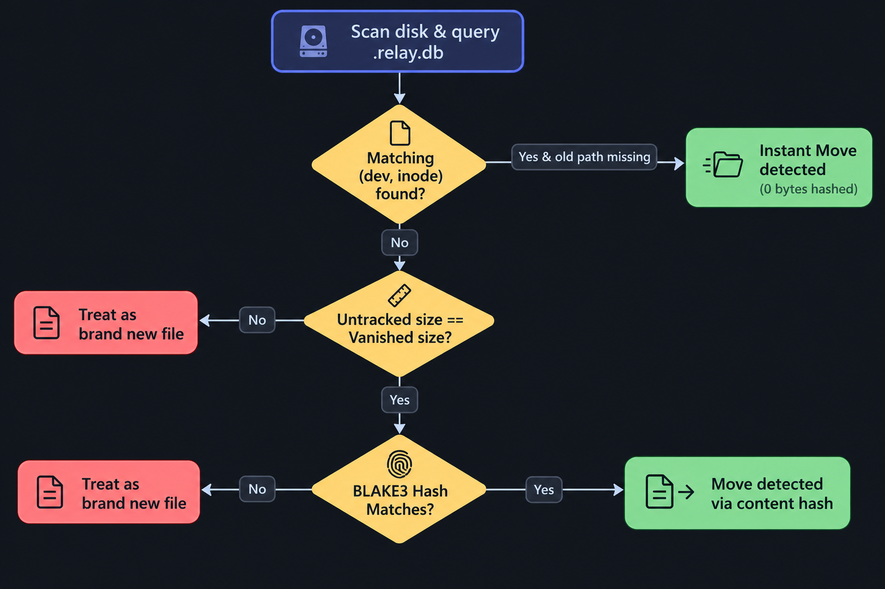
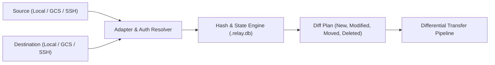

# Relay ⚡

> **A seamless, environment-agnostic sync tool combining the differential speed of `rsync` with the state tracking and content-addressable model of `git`.**

Sync files between any environment with a single command — whether it's a local directory, a Google Cloud Storage bucket, a GCP Cloud Shell session, or an SSH-accessible GCP Workbench / JupyterLab instance.

```bash
relay sync <source> <destination>
```

---

## 💡 The Core Idea



Developers, data scientists, and ML engineers constantly move code, models, and data between disparate environments:
- Local laptop (`c:/dev/project1` or `~/dev/project1`)
- Google Cloud Storage (`gcs://bucket/project1`)
- GCP Cloud Shell
- GCP Vertex AI / Compute Workbench instances (`ssh europe-west3/workbench-name/...`)

Traditional tools require different commands, different syntax, and manual credential juggling:
- `rsync` does not natively speak cloud object storage.
- `gcloud storage rsync` does not directly sync into remote SSH workbench instances without tunneling and multi-step hops.
- Cloud tools often miss local state tracking, re-hashing or re-uploading unchanged files.

**Relay** dynamically parses source and destination endpoints, authenticates automatically, computes hashes, detects modified and moved files, and differential-syncs only what changed.

---

## 🎯 Current Scope

Relay currently targets the GCP and data science ecosystem:

| Environment | Example URI / Format | Authentication Handled |
| :--- | :--- | :--- |
| **Local Filesystem** | `.` or `/home/user/project` or `C:\dev\project` | Native OS permissions |
| **Google Cloud Storage** | `gcs://bucket-name/path` or `gs://bucket-name/path` | GCP ADC / `gcloud auth` |
| **GCP Cloud Shell** | Local paths in Cloud Shell | Built-in environment |
| **GCP Workbench / SSH VM** | `ssh europe-west3/instance-name/path [--no-tunnel]` | GCP SSH wrapper / SSH keys |

---

## 🚀 Quick Usage

### 1. Sync Local Folder to Google Cloud Storage
```bash
relay sync . "gcs://vineetk/uploads/project1"
```

### 2. Sync GCS Bucket to a GCP Workbench (JupyterLab)
```bash
relay sync "gcs://vineetk/uploads/project1" "ssh europe-west3/vineetk-instance/usr/project1 --no-tunnel"
```

### 3. Sync Local to Remote Workbench
```bash
relay sync ./model_weights "ssh us-central1/jupyter-gpu/home/jupyter/model_weights"
```

### 4. Cloud Shell to GCS Bucket
```bash
relay sync ~/repo "gcs://my-backup-bucket/repos/repo"
```

---

## ⚙️ How Relay Works



1. **Dynamic Environment Resolution**: Relay inspects the source and target schemes (`gcs://`, `ssh ...`, or local filesystem paths) and loads the corresponding transport adapter.
2. **State & Metadata Ledger (`.relay.db`)**: Tracks file paths, sizes, timestamps (`mtime`), and cryptographic digests locally in a fast SQLite database.
3. **Smart Change Verification**:
   - Quick check: Compare file size and timestamp `mtime` against the ledger.
   - Deep check: High-speed BLAKE3 hash computation for local files, paired with cloud-native digests (CRC32c / MD5 or object metadata) for GCS objects.
4. **Rename & Move Detection**: Identifies moved files by comparing content hashes instead of treating a rename as an expensive delete + full re-upload.
5. **Differential Transfer**: Transfers only deltas or newly added files, executing server-side copies for moved files when remote object storage allows it.
6. **Ignore Rules (`.relayignore`)**: Prevents clutter like `.git`, `__pycache__`, `node_modules`, and virtual environments from syncing.

---

## 🛠️ Installation & Setup

### Prerequisites
- Python `>= 3.12`
- [`uv`](https://github.com/astral-sh/uv) (recommended) or `pip`
- Google Cloud SDK (`gcloud`) installed and authenticated for GCS / GCP Workbench features.

### Install via `uv`
```bash
git clone https://github.com/vineetkushwaha/relay.git
cd relay
uv sync
```

### Run Locally
```bash
# Run scan / debug
uv run relay

# Or using make
make run
```

---

## 🗺️ Roadmap

- [x] Initial local scanning and BLAKE3 hashing.
- [x] SQLite-backed state ledger (`.relay.db`).
- [x] `.relayignore` pattern matching.
- [ ] Rename & move detection engine (content-addressable diffs).
- [ ] GCS adapter (`gcs://` bucket sync via google-cloud-storage).
- [ ] GCP Workbench / SSH adapter (streamlined `gcloud compute ssh` / native SSH transport).
- [ ] Bi-directional sync & conflict resolution.
- [ ] Watch mode (`relay watch <src> <dest>`) for live syncing.

---

## 📄 License

MIT
